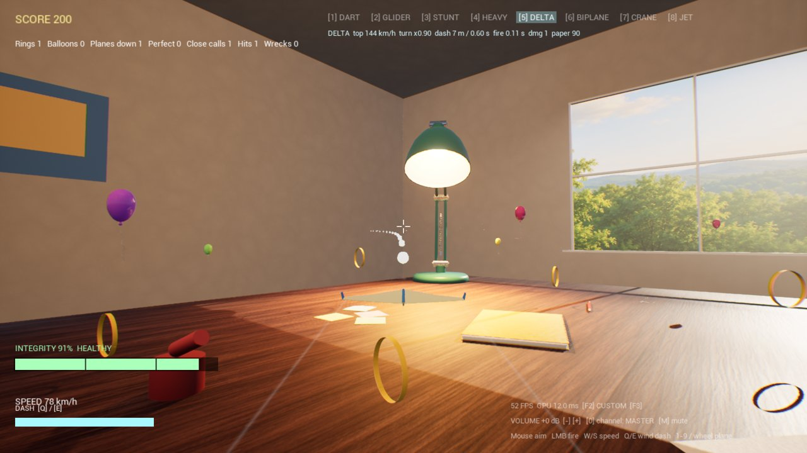

# claude-unreal-agent-es

[English](https://github.com/davidricardobc/claude-unreal-agent) · **Español**

Un agente permanente de Unreal Engine 5.8 para Claude Code: una definición de agente, 15 skills y unas pocas herramientas. Guarda una memoria en disco, la lee al empezar cada conversación y la actualiza al terminar, así que mejora sesión a sesión en vez de empezar de cero.


## Qué construyó

**TableFlyer**, un juego arcade pequeño hecho en 9 rondas: un avión de papel sobre un escritorio gigante, con aros, globos, aviones enemigos, daño por choque en etapas, 8 aviones, un nivel de práctica de vuelo libre con campo de tiro y contrarreloj, un modo "piloto" opcional con loops reales y un pedestal que muestra assets importados desde Blender. Todo en C++ con UE 5.8.4, probado y empaquetado por el agente, muchas veces sin ventana abierta mientras el dueño jugaba en la misma laptop.

| | |
|---|---|
|  |  |
|  | Clip de 14 s: [`examples/tableflyer/tableflyer_clip_14s.mp4`](examples/tableflyer/tableflyer_clip_14s.mp4) (grabado cuadro por cuadro, 30 fps exactos) |

## Qué trae

```
agents/unreal-agent.md        la definición del agente (subagente de Claude Code)
skills/<nombre>/SKILL.md      15 skills con scripts y pruebas sin conexión
tools/                        upy.py (Python en el editor abierto), mcp.py (cliente del MCP de Epic), pie.py (ayudas de Play In Editor)
memory-template/              memoria vacía + cómo usarla (README)
examples/memory-example/      una memoria real de TableFlyer, hecha genérica
examples/                     lecciones de UE 5.8, renders y clip de TableFlyer
```

## Por qué funciona

Tres partes, cada una cubre lo que las otras no pueden:

- **Memoria (experiencia).** El agente anota lo que pasó, con evidencia: cada lección dice cómo se verificó (una compilación, una línea de log, una captura, un número), cada error guarda el mensaje exacto, la causa y el arreglo, y cada decisión guarda su razón. Lo lee antes de actuar, así que no se paga dos veces la misma trampa. La mayoría de los fallos en 9 rondas fueron trampas del entorno (la reescritura de rutas del shell, un editor frenado, un exe bloqueado), y cada una se pagó una sola vez. Ver [`examples/memory-example/`](examples/memory-example/).
- **Skills (procedimiento).** El "cómo" reutilizable: preflight, ediciones seguras por MCP, empaquetado, renders, pruebas de vuelo, losetas de nivel, tráilers. Cuando un patrón se repite dos veces se vuelve skill (`ue-game-round` salió así); cuando una skill falla en un proyecto real, el arreglo vuelve a la skill.
- **Verificación (honestidad).** Nada está "hecho" sin prueba. Los ganchos `Debug*` en C++ permiten al agente manejar el juego por MCP y leer el log, sin una persona en el teclado. Lo que no se probó se marca "sin verificar". Correr las skills en un proyecto real encontró 10 errores que sus pruebas sin conexión nunca vieron: por eso las skills de abajo dicen dónde se probaron.

Además, límites duros (nada de push, publicar ni créditos de pago sin un sí explícito; los secretos nunca se leen) y una autoevaluación: una fila de eficacia por sesión y, cada 3 sesiones, el agente propone cambios a su propio flujo.

## Instalación (probada en un proyecto C++ en blanco de UE 5.8.4)

Requisitos: Windows (probado en 11), Claude Code, Unreal Engine 5.8, Visual Studio 2022 17.14 o superior, o 2026, con el desarrollo de juegos en C++, Python 3.11 o superior y PowerShell 5.1. Opcionales: Node 18 o superior (skill de audio) y ffmpeg (skill del tráiler).

1. **Agente y skills.** Copia `agents/unreal-agent.md` a `<proyecto>/.claude/agents/` y `skills/*` a `<proyecto>/.claude/skills/` (o las dos cosas a `~/.claude/` para todos los proyectos).
2. **Casa del agente.** Crea una carpeta (de preferencia un repo git local) y copia ahí `memory-template/memory`, `memory-template/sessions` y `tools/`. En `unreal-agent.md`, cambia `<AGENT_HOME>` por esa carpeta y `<KIT_DIR>` por la carpeta que contiene `skills/` (`<proyecto>/.claude` o `~/.claude`).
3. **Plugins.** Agrega esto a `"Plugins"` en tu `.uproject` (todos solo de editor):
   ```json
   {"Name": "ModelContextProtocol", "Enabled": true, "TargetAllowList": ["Editor"]},
   {"Name": "AllToolsets", "Enabled": true, "TargetAllowList": ["Editor"]},
   {"Name": "PythonScriptPlugin", "Enabled": true, "TargetAllowList": ["Editor"]},
   {"Name": "EditorScriptingUtilities", "Enabled": true, "TargetAllowList": ["Editor"]}
   ```
   Para tráilers, también `{"Name": "MovieRenderPipeline", "Enabled": true}`.
4. **Compila** el target del editor una vez (un proyecto C++ no abre sin eso):
   `"<UE_ROOT>\Engine\Build\BatchFiles\Build.bat" <Proyecto>Editor Win64 Development -Project="<ruta>\<Proyecto>.uproject" -WaitMutex`
5. **Abre el editor con el servidor MCP:**
   `"<UE_ROOT>\Engine\Binaries\Win64\UnrealEditor.exe" "<ruta>\<Proyecto>.uproject" -ModelContextProtocolStartServer -ModelContextProtocolPort=8123`
   Guarda un mapa (File > Save Current Level). Un proyecto recién creado arranca en un mapa sin guardar y el preflight reporta amarillo hasta que lo guardes.
6. **Configuración única del editor** (ejecución remota de Python + sin freno de CPU en segundo plano):
   `python .claude/skills/ue-session-preflight/scripts/setup_editor.py` → `SETUP_OK`.
   Comprueba: `python .claude/skills/ue-session-preflight/scripts/mcp_check.py --url http://127.0.0.1:8123/mcp` y `python <AGENT_HOME>/tools/upy.py -c "print('ok')"`.
7. **Variables de entorno** (terminal nueva después de `setx`): `setx UE_ROOT "C:\Program Files\Epic Games\UE_5.8"`. Opcionales: `UE_MCP_URL` (por defecto `http://127.0.0.1:8123/mcp`), `UE_PIE_MAP`, `UE_PROJECT_DIR`. Las claves de API (skill de audio) se leen solo de variables de entorno y nunca se imprimen.
8. Pídele a Claude Code: "usa el unreal-agent para ...".

Empaquetar un proyecto con los plugins del MCP necesita una regla en `DefaultGame.ini` (el cook falla sin ella); está en `skills/package-and-verify-build/SKILL.md`, sección "Errores típicos".

## Skills y dónde se probaron

| Skill | Qué hace | Probada en |
|---|---|---|
| `ue-session-preflight` | el editor y el MCP responden, Python remoto, freno de segundo plano, exe abierto | proyecto en blanco + TableFlyer |
| `ue-game-round` | el ciclo: construir, ganchos, pruebas en PIE, capturas, empaquetar, reportar | TableFlyer (9 rondas) |
| `ue-mcp-safe-edit` | leer, escribir y releer por el MCP de Epic | TableFlyer |
| `ue-headless` | compilaciones y Python sin ventana | TableFlyer |
| `ue-viewport-eyes` | capturas baratas para revisar | TableFlyer |
| `ue-render-shots` | renders de presentación, clips cuadro por cuadro | TableFlyer |
| `package-and-verify-build` | BuildCookRun, prueba de humo con sonido | proyecto en blanco + TableFlyer |
| `flight-test-pilot` | maniobras con guion, métricas, ajuste de PID; trae un pawn de referencia | proyecto en blanco + TableFlyer |
| `build-tile` | losetas modulares de nivel, prueba de giro en PIE | proyecto en blanco + TableFlyer |
| `trailer-shot-prep` | lista de tomas a Level Sequences a Movie Render Queue a video | proyecto en blanco (render real) + TableFlyer |
| `gdd-to-datatables` | tablas de diseño a CSV, USTRUCT y Data Tables | TableFlyer |
| `playtest-telemetry-balance` | subsistema de telemetría en CSV y resumen de balance | TableFlyer |
| `asset-intake` | assets de terceros o de IA con licencias | TableFlyer (parcial) |
| `metasound-engine-family` | sonidos de motor y de flujo de aire con MetaSounds (script de la Builder API) | TableFlyer |
| `elevenlabs-sfx-batch` | efectos de sonido por lotes con tope de créditos (API de pago) | TableFlyer |

## Pruebas

Pruebas sin conexión (sin Unreal ni red), desde la raíz del repo:

```
python -I -m unittest discover -s skills/<nombre>/tests
python -I skills/gdd-to-datatables/tests/test_gdd.py
python -I skills/playtest-telemetry-balance/tests/test_playtest.py
node --test skills/elevenlabs-sfx-batch/tests/lib.test.mjs skills/elevenlabs-sfx-batch/tests/generate-fake-server.test.mjs
```

Última corrida completa en Windows 11 con Python 3.14 y Node 24: 167 pruebas unitarias, 15 pruebas de Node y 2 scripts independientes, todo en verde.

Los scripts terminan con tokens estables: `KIT_OK`, `KIT_FAIL`, `SETUP_OK`, `FLIGHT_PASS`, `VIDEO_OK`.

## Límites conocidos

- Los mensajes de consola que imprimen los scripts están en español, el idioma original de los scripts. Los tokens y el código están en inglés. Los comentarios, los docstrings y toda la documentación están en español.
- Solo Windows por ahora. Algunos pasos necesitan a una persona: iniciar sesión en servicios, escuchar el audio, el sí final para publicar.
- Unas pocas notas antiguas dentro de algunas skills todavía dicen "sin verificar" sobre partes que una sección posterior de "Estado" o "Verificado en TableFlyer" confirma; la sección con fecha es el estado actual.
- `elevenlabs-sfx-batch` tiene una compuerta de inicio opcional (`KIT_START`, apagada por defecto) que bloquea la generación de audio del juego antes de una fecha, para concursos o hitos.

## Autor y licencia

De David Bajonero. Licencia MIT, ver [`LICENSE`](LICENSE). Nota en español: el texto legal está en inglés, que es lo estándar. En corto, puedes usar, copiar, modificar y distribuir este software, también con fines comerciales, siempre que conserves el aviso de copyright y el texto de la licencia. Se entrega "tal cual", sin garantía de ningún tipo. Los renders de ejemplo muestran un proyecto hecho por el autor y el agente. La revisión de seguridad de este repo está en [`REVISION_SEGURIDAD.md`](REVISION_SEGURIDAD.md).
